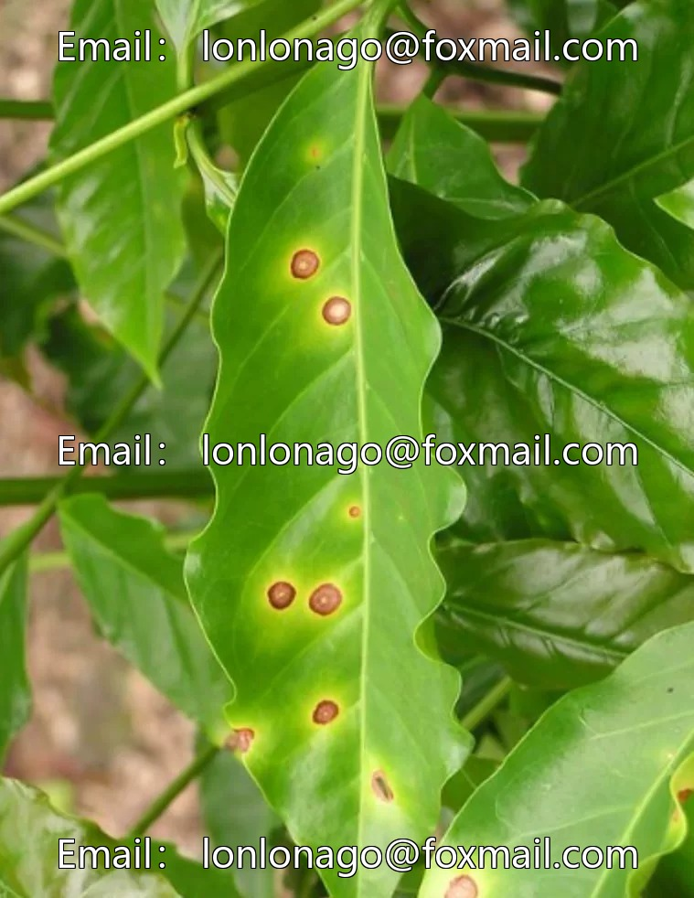
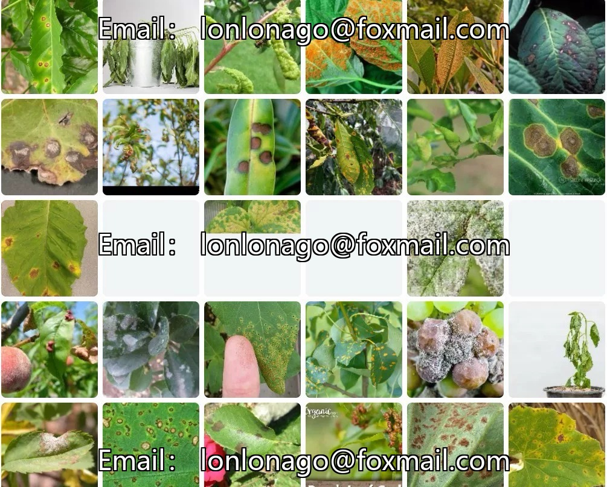
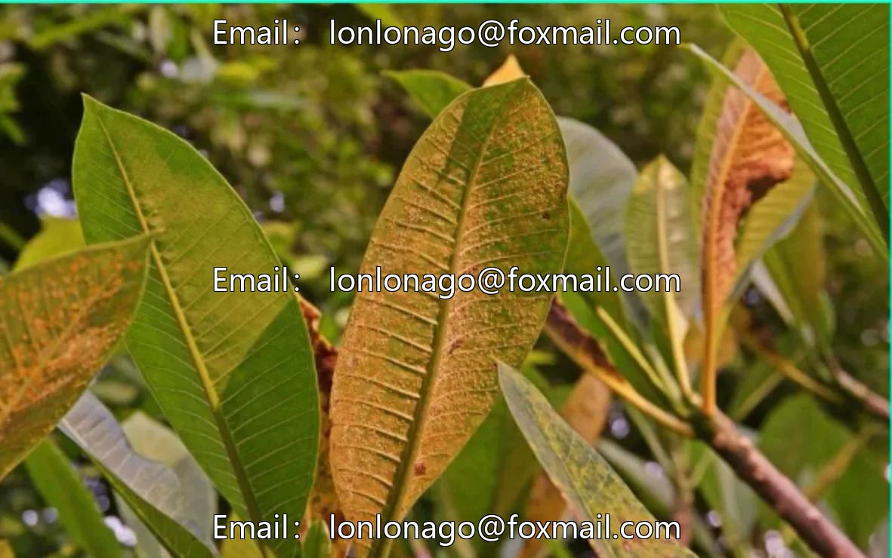
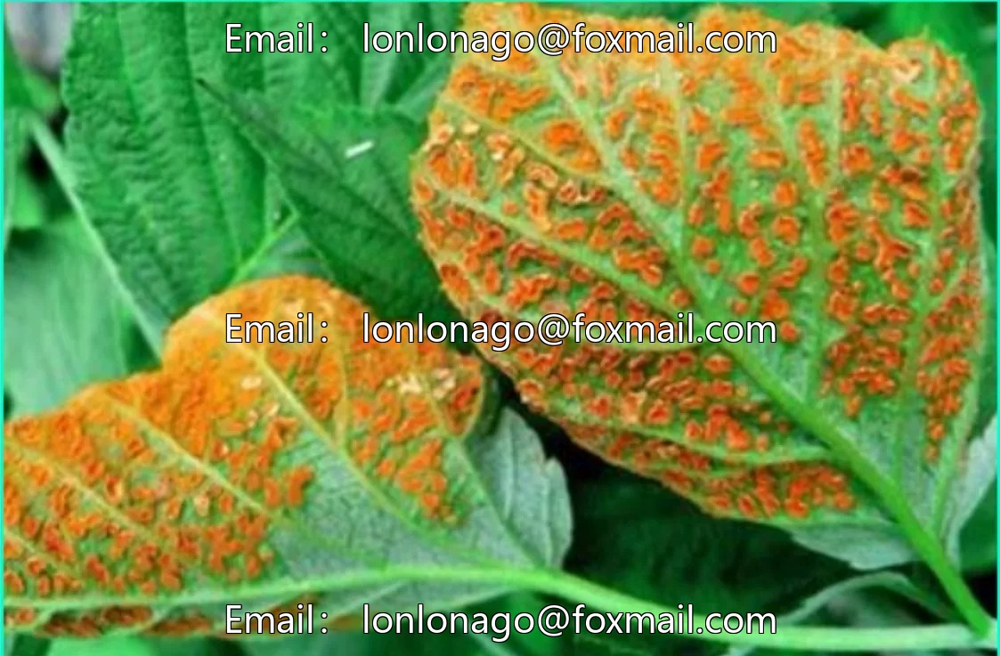
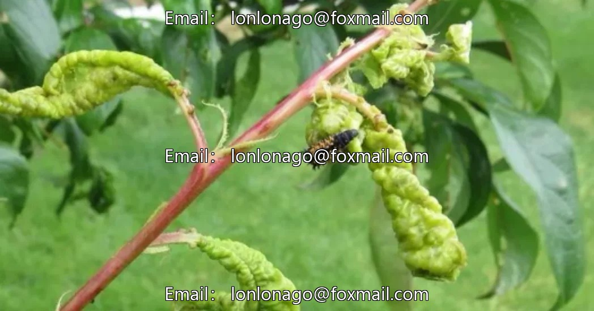

# Plant leaf diseases and pests identification dataset

## Body

Plant Leaf Disease and Pest Identification Dataset
1048 images, 10 subcategories: Black Spots, Scab, Endothia Parasitica Blight, Botrytis Blight, Colletotrichum Leaf Blight, Powdery Mildew, Rust, Sclerotinia Leaf Blight, Rolling Leaves, Dead Plants. Supports image drag-and-drop detection, in the format of image files, suitable for automated plant disease detection. Both model training and testing can be used.

The dataset focuses on plant disease detection, with high segmentation and covers common diseases. The model is directly usable without the need for additional data preparation, reducing the application barrier.

Virtual materials, once sold, are non-refundable.
Interested friends, click "I want" to proceed.

## Images

## Payment

Here is a pay link on Stripe ( https://buy.stripe.com/3cs8yP7sY87d0vu9AB ). Please contact me lonlonago@foxmail.com after funding $89, and I will send you a complete data files , thank you!

